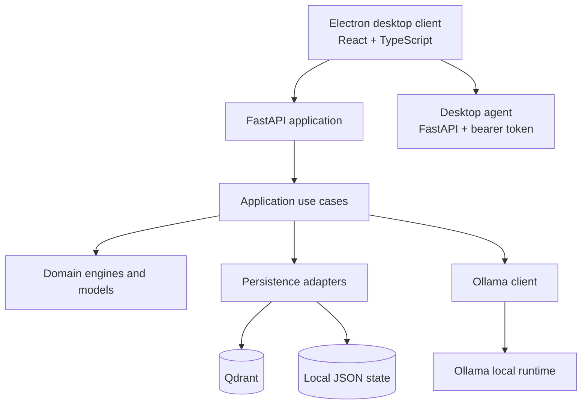

# Aletheia

**Local-first personal AI assistant built with Python, FastAPI, Ollama, Qdrant and an Electron + React desktop client.**

Aletheia is an experimental, privacy-oriented assistant designed to run on a user's own machine. The project combines a conversational API, persistent memory, configurable personality context, goal tracking and an optional initiative loop. The desktop companion exposes selected local actions through an authenticated agent.

> **Project status:** personal MVP / active development. This repository demonstrates an evolving architecture and working components; it is not presented as a production-hardened or fully validated commercial product.

## What it does

- **Local conversational backend:** FastAPI application that delegates text generation to a local Ollama instance.
- **Persistent semantic memory:** Qdrant-backed memory integration, with local application state stored separately.
- **Context assembly:** builds a per-turn cognitive workspace from memory, goals, personality and other state.
- **Goals and continuity:** detects explicit user goals, persists them and can bring relevant goals back into context.
- **Optional initiative loop:** evaluates inactivity and cooldown rules before creating a pending suggestion. It can be paused.
- **Desktop companion:** React + TypeScript interface packaged with Electron.
- **Controlled desktop actions:** a separate FastAPI agent protects its endpoints with bearer-token authentication and an allowlist of applications.

The project does **not** claim consciousness, subjective emotions or unrestricted autonomous computer control. Its behavior is implemented through explicit software components and user-configurable rules.

## Architecture



### Main backend areas

| Area | Responsibility |
|---|---|
| `app/api` | HTTP routes and request/response schemas |
| `app/application` | Use cases and orchestration |
| `app/domain` | Domain models and contracts |
| `app/modules` | Goal, initiative, personality, emotion and relationship engines |
| `app/infrastructure` | Ollama, Qdrant and local persistence adapters |
| `desktop_agent` | Authenticated local desktop-action API |
| `ui` | Electron + React + TypeScript desktop client |
| `tests` | Automated backend and agent tests |

## Technology stack

- **Backend:** Python 3.11, FastAPI, Pydantic
- **LLM runtime:** Ollama (local model required)
- **Semantic memory:** Qdrant
- **Desktop:** Electron, React, TypeScript, Vite
- **Local services:** Docker Compose
- **Testing and quality:** pytest, pytest-asyncio, Ruff, ESLint, TypeScript

## Run locally

### Prerequisites

- Python 3.11
- Docker Engine and Docker Compose plugin
- Node.js and npm (for the desktop client)
- Ollama with a model downloaded locally
- Git

### 1. Clone and configure

```bash
git clone https://github.com/yafAram/Aletheia.git
cd Aletheia
cp .env.example .env
```

Review `.env` and set the model/runtime values for your machine. Never commit `.env`, tokens, model files or personal storage data.

### 2. Start local infrastructure

```bash
docker compose up -d qdrant ollama
```

Ensure Ollama is running and that the model configured in `.env` is available. Model names and hardware requirements depend on the local environment.

### 3. Install and run the API

```bash
python3.11 -m venv .venv
source .venv/bin/activate
python -m pip install --upgrade pip
pip install -r requirements.txt
uvicorn app.main:create_app --factory --host 127.0.0.1 --port 8000 --reload
```

Health endpoint: [http://127.0.0.1:8000/health](http://127.0.0.1:8000/health)

### 4. Run the desktop client

In a second terminal:

```bash
cd ui
npm ci
npm run desktop:dev
```

For browser development, use `npm run dev`.

> Voice features may require optional dependencies and compatible local speech models. They are not required to run the basic API tests.

## Tests and quality checks

Install development dependencies:

```bash
pip install -r requirements-dev.txt
pytest -q
python -m compileall -q app desktop_agent tests
```

Validate the desktop client:

```bash
cd ui
npm ci
npm run lint
npm run build
```

The GitHub Actions workflow runs backend tests and desktop lint/build checks on pushes and pull requests. A green workflow verifies those automated checks only; it does not prove that every local model, audio device, GPU or desktop integration works on every machine.

## Security and privacy

- Keep `.env`, local tokens, user memory, audio and model weights out of Git.
- Use `.env.example` only for non-sensitive placeholders.
- The desktop agent uses bearer-token authentication and an application allowlist; do not expose it to an untrusted network.
- Review [SECURITY.md](SECURITY.md) before reporting a vulnerability.
- Local execution reduces dependence on hosted inference, but does not by itself guarantee privacy: review network exposure, logs, backups and the behavior of any enabled integration.

## Project documentation

- [Architecture overview](docs/ARCHITECTURE.md)
- [Desktop agent](docs/AGENTE_ESCRITORIO.md)
- [MVP test notes](docs/PRUEBAS_MVP.md)
- [Evolution notes](EVOLUCION_ALETHEIA.md)
- [Contributing guide](CONTRIBUTING.md)
- [Security policy](SECURITY.md)

## Roadmap

- [ ] Expand unit tests for application and infrastructure boundaries.
- [ ] Add integration tests with isolated Qdrant/Ollama test doubles or containers.
- [ ] Add reproducible desktop-agent packaging and platform smoke tests.
- [ ] Document configuration and failure modes for voice modules.
- [ ] Add structured logging and operational diagnostics.
- [ ] Validate backup, restore and data-retention behavior.

## Author

**Yafte Aram Mercado Meza**  
Software development graduate | Backend-focused developer

- GitHub: [@yafAram](https://github.com/yafAram)
- Portfolio projects: [Operaciones-G3](https://github.com/yafAram/Operaciones-G3) · [ViajandoAndo](https://github.com/yafAram/ViajandoAndo) · [API_SLIM_PHP](https://github.com/yafAram/API_SLIM_PHP)

---

Aletheia is an independent learning and engineering project. Features and operational guarantees are limited to what is implemented and covered by the repository's current tests.
