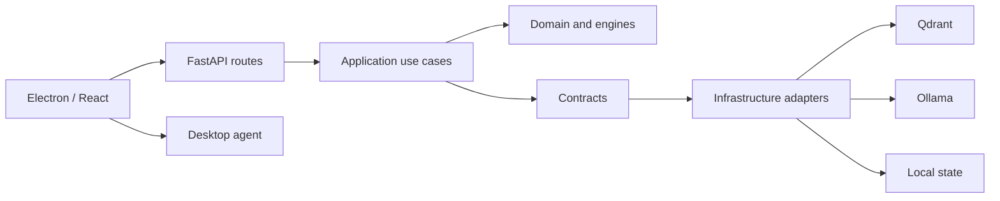

# Architecture

## Design overview

Aletheia is organized as a modular Python application with explicit separation between HTTP delivery, application orchestration, domain behavior and infrastructure adapters.

## Responsibilities

- **API:** validates HTTP input, invokes application services and serializes responses.
- **Application:** coordinates chat, context assembly, goal persistence and initiative scheduling.
- **Domain:** owns models and deterministic behavior that should not require FastAPI or external services.
- **Infrastructure:** implements persistence and external-runtime integrations (Qdrant, Ollama and local files).
- **Desktop agent:** exposes a separate, authenticated API for a constrained set of local desktop operations.
- **UI:** presents chat and desktop controls; it does not own backend business rules.

## Important runtime boundaries

1. Ollama is an external local process. API health does not guarantee model availability.
2. Qdrant is a separate service. Semantic memory requires it to be reachable.
3. The initiative loop is a background task started and stopped with the FastAPI lifespan.
4. Local JSON stores are application state. Back them up before changing storage or permissions.
5. The desktop agent is a privileged local boundary. Keep its bearer token private and its application allowlist narrow.

## Testing strategy

- Unit tests cover deterministic domain behavior and prompt/context assembly.
- Store tests use temporary directories to avoid touching a developer's real state.
- API tests use FastAPI's test client and should not require a real LLM.
- Integration tests for Qdrant/Ollama and desktop packaging remain separate follow-up work.
